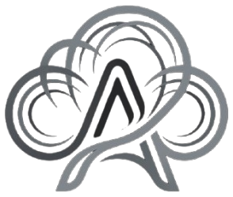

<p align="center">
  
</p>

<h1 align="center">Auram Photo</h1>

<p align="center">Open-source photo editing and graphic design, part of the Auram creative ecosystem.</p>

---

Auram Photo is a layer-based raster editor for Windows. It is installed, updated and launched by
[Auram Launcher](https://github.com/deziemniakv/Auram-Launcher) and saves work in the shared Auram
project format (`.cproj`), which the launcher lists with names and thumbnails.

> **Status: early development (0.1.0, milestone 1).** The core editor works; many features a
> photo editor needs are not built yet. See [What works today](#what-works-today) and the
> [roadmap](#roadmap).

## What works today

| Area                                                                                                                      | Status                                                             |
| ------------------------------------------------------------------------------------------------------------------------- | ------------------------------------------------------------------ |
| New image (presets, white / transparent / colour background), open PNG, JPEG, WebP, GIF, BMP                              | Implemented                                                        |
| Layers: add, duplicate, delete, reorder, rename, visibility, opacity, 16 blend modes, merge down                          | Implemented                                                        |
| GPU compositing (WebGL 2) with pan, zoom and smooth zoom-out                                                              | Implemented; verified against a CPU reference for every blend mode |
| Tools: move, rectangular and elliptical marquee (new / add / subtract / intersect), brush, eraser, eyedropper, hand, zoom | Implemented                                                        |
| Fill, clear, select all / deselect / invert, flip canvas                                                                  | Implemented                                                        |
| Undo / redo with memory limits                                                                                            | Implemented                                                        |
| Save and open `.cproj` projects (lossless per-layer PNG, thumbnail for the launcher)                                      | Implemented                                                        |
| Export PNG (lossless), JPEG, WebP                                                                                         | Implemented                                                        |
| English and Polish interface                                                                                              | Implemented                                                        |
| Launcher integration: opens projects passed by Auram Launcher, release manifest generation                                | Implemented                                                        |
| Pressure sensitivity, adjustments, filters, text, shapes, transform, crop, resize, colour management                      | Not yet                                                            |

## Development

Requirements: **Node.js 22.12+** and **pnpm 10** (`corepack enable`).

```sh
pnpm install
pnpm dev                     # editor with hot reload
pnpm check                   # lint + typecheck + unit tests + build
pnpm build && pnpm test:e2e  # end-to-end tests (Linux: xvfb-run -a pnpm test:e2e)
pnpm package:win             # Windows ZIP + auram-release.json (run on Windows)
```

Use throwaway folders to keep your real data untouched:

```sh
AURAM_DATA_DIR=/tmp/photo/data AURAM_DOCUMENTS_DIR=/tmp/photo/docs pnpm dev
```

`AURAM_LANGUAGE=pl` forces the Polish interface.

## Repository layout

```
apps/photo/              Electron application (main, preload, renderer)
packages/engine/         Document model, raster operations, brush, selections, history,
                         .cproj reader/writer and the WebGL 2 compositor
packages/design-tokens/  ┐
packages/ui/             │ shared with Auram Launcher (vendored, see packages/README.md)
packages/project-format/ │
packages/app-manifest/   ┘
docs/                    Architecture, document format, release process
scripts/                 Licence list, app descriptor and release manifest generation
```

## Documentation

- [Architecture](docs/architecture.md)
- [Document format](docs/document-format.md)
- [Releasing](docs/release.md)

## Roadmap

Milestone 2 candidates, roughly in priority order: image and canvas resize, crop, free transform,
adjustments (levels, curves, hue/saturation) as non-destructive adjustment layers, pen pressure,
text and shape layers, layer masks, larger-than-canvas layers, colour management (ICC), and a
CPU rendering fallback for machines without WebGL 2.

## Contributing and security

See [CONTRIBUTING.md](CONTRIBUTING.md), [CODE_OF_CONDUCT.md](CODE_OF_CONDUCT.md) and
[SECURITY.md](SECURITY.md).

## License

Source code: [Apache License 2.0](LICENSE). The Auram name and logo are not covered by that
license; see [NOTICE](NOTICE).
